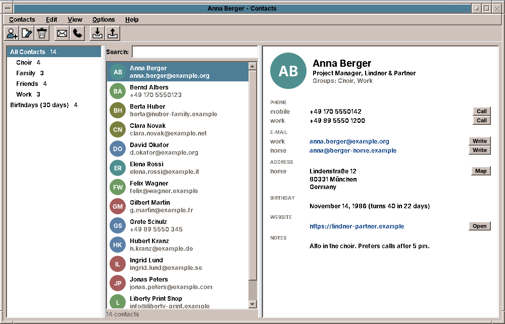

# amade-contacts

**amade-contacts** is the address book of the [amadeOS](https://github.com/amadeos-eu/amadeos) desktop: people and organizations with phone numbers, e-mail and postal addresses, birthdays, groups, notes and a photo. Every contact is a vCard file of its own, so phones, other programs and synchronisation tools can read it too. Built like the other amadeOS applications.




## Features

- **Three columns**: on the left *All Contacts*, the groups and *Birthdays* (the next 30 days, soonest first); in the middle the contacts with photo or initials; on the right the card of the selected contact.
- **Search** (Ctrl+F) over names, organization, e-mail addresses, phone numbers (by their digits, so `5550123` finds `+49 170 555 0123`), addresses, groups and notes. Accents do not count: `weiss` finds *Weiß*.
- **Editing** (Ctrl+N, Ctrl+E or a double click): name parts, display name, nickname, organization and job title, as many phone numbers, e-mail and postal addresses and websites as needed (mobile, home, work, fax, other), birthday with or without year, groups, notes and a photo (cut square and stored at 256 pixels).
- **Reaching people** from the card: *Write* opens a new mail in the mail program (Ctrl+M for all selected contacts), *Call* hands the number to a program for `tel:` links or copies it, *Map* shows the address on OpenStreetMap, websites open in the browser.
- **Import** (Ctrl+I, drag and drop, or a `.vcf` opened from the file manager): vCard 2.1, 3.0 and 4.0 (Android, iPhone, Thunderbird, Evolution), CSV from Google Contacts and Outlook (also German Outlook in Windows-1252) and other tables, and LDIF from Thunderbird. The dialog shows what each column becomes and lets it be changed, finds contacts whose e-mail address is already known and merges them, and puts the new ones into a group *Imported (date)*.
- **Export** (Ctrl+Shift+E) of the selected or all listed contacts as vCard 4.0, vCard 3.0 (older phones), CSV for Google or Outlook, or LDIF.
- **Clipboard**: Ctrl+C copies "Name &lt;address&gt;" lines for a mail, Ctrl+Shift+C the contacts as vCards, Ctrl+V adds vCards from the clipboard.
- Sort by first or last name (*View*). Files changed by other programs are read again when the window becomes active.
- Five languages (English, Deutsch, Français, Español, Italiano), following the amadeOS desktop language; *Options → Language* overrides it.
- Theme colours and Motif look from [amade-commons](https://github.com/amadeos-eu/amade-commons).

## Where the contacts are

```
~/.local/share/amadeos/contacts/
└── personal/
    ├── displayname                 the name of the address book
    ├── 4f1c…-….vcf                 one vCard 4.0 file per contact
    └── …
```

This is the *vdir* layout that [vdirsyncer](https://github.com/pimutils/vdirsyncer) and khard use, so a CardDAV server (Nextcloud, Radicale, mailbox.org …) can be synchronised with it today, and amade-contacts reads what vdirsyncer writes. Further folders next to `personal` are further address books. A file is written as a whole and then moved into place, so a crash never leaves half a contact. When a contact is edited, only the changed properties are written anew; what other programs put into the file (instant messaging, phonetic names, `X-` properties) stays.

## Architecture

Java 25, Swing and Guice; start-up, theme and language come from `AmadeApplication` in amade-commons. vCards are read and written with [ez-vcard](https://github.com/mangstadt/ez-vcard) (BSD licence).

| Package | Contents |
|---|---|
| `bootstrap` | `AmadeContactsApplication`, `ContactsModule` |
| `domain` | `Contact`, `Name`, `Entry` and `Kind` (phone and e-mail with mobile, home, work …), `PostalAddress`, `Birthday` (with or without year), `Photo`, `Source` (all, address book, group, birthdays), `Settings` |
| `io` | `VCards` (vCard ↔ `Contact`, keeping unknown properties), `CsvTable`, `ColumnMapping` (guesses what a column holds, in five languages), `CsvContacts` (Google, Outlook, others), `Ldif`, `TextFiles` (UTF-8, UTF-16 or Windows-1252), `FileFormat`, `ImportFile`, `Exports` |
| `repository` | `AddressBooks` (the vdir folders), `ContactsPreferences` (`~/.config/amadeos/contacts/contacts.properties`) |
| `service` | `ContactImport` (merging by e-mail address, the import group) |
| `ui.main` | window, presenter, menus, `ContactCard`, `Avatar`, `ContactsGlyph` |
| `ui.editor` | `ContactEditor` with its rows, `Photos` |
| `ui.transfer` | `ImportDialog`, `ExportDialog` |

The presenter knows the window only through the `MainView` interface, so the tests drive the whole address book (search, groups, editing, import, export, mail and call links) without Swing.

## Build and run

```sh
./gradlew run                              # start
./gradlew run --args="contacts.vcf"        # start and import a file
./gradlew test                             # Swing tests need a display: xvfb-run ./gradlew test
./gradlew deb                              # build/distributions/amade-contacts_<version>_all.deb
./gradlew installToAmadeOs                 # the .deb into ../amadeos/config/packages.chroot/ for the ISO build
```

If `../amade-commons` is checked out next to this repository, Gradle builds against that checkout instead of the JitPack version.

## Planned

- Contacts for other programs: completion of addresses in amade-mail, attendees and a birthday calendar in amade-calendar
- Synchronisation with a CardDAV server from the program itself
- Merging two contacts by hand, and finding duplicates without an import
- Printing an address list and labels

## License

[EUPL-1.2](LICENSE)
